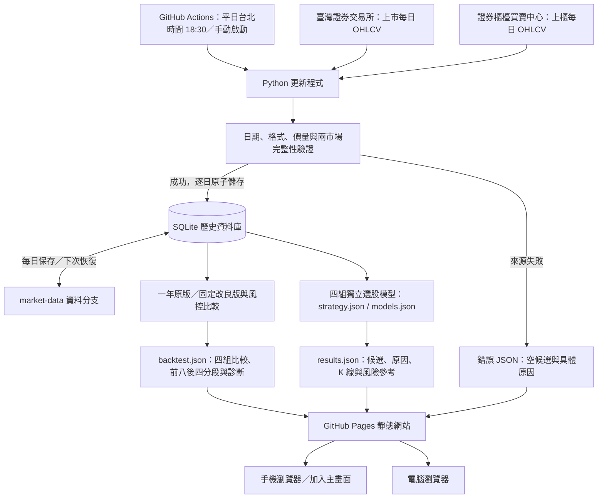

# 手機版系統架構

手機只需開啟發布後的 HTTPS 網址，不必安裝 Python、不需要登入，也不會直接向交易所密集查詢。桌機與手機使用同一個響應式網站；網站資訊以最近成功公布的官方收盤資料為準。

## 手機上可以操作什麼

- 查看行情日期、更新時間、實際候選數與錯誤／資料過期警示。
- 依上市／上櫃篩選，以股票代號或名稱搜尋，依排序分數或風險報酬比排列。
- 查看紅漲綠跌 K 線、成交量、支撐、停損、參考目標與量化入選原因。
- 展開本次策略參數。修改策略需在儲存庫調整並重新執行，不會在手機端私自套用不同條件。
- 在瀏覽器的選單／分享選單選擇「加入主畫面」（名稱依瀏覽器而異）。網站提供 manifest、名稱、圖示與獨立視窗設定；未建立離線行情快取，避免離線時將過期結果當成最新資料。

## 資料與部署分工

| 位置 | 責任 |
| --- | --- |
| Python / SQLite | 官方資料取得、歷史保存、增量修正、量化條件與錯誤處理 |
| GitHub Actions | 定時執行、測試、資料分支保存、網站 artifact 與部署 |
| market-data 分支 | 持久保存資料庫與最近一次更新狀態，不含自動下單程式 |
| GitHub Pages | 提供靜態網站與結果 JSON，不執行 Python、不直接連券商 |
| 手機 / 電腦 | 顯示與篩選已產生的候選，不進行交易 |

一開始沒有資料或資料來源失敗時，網站顯示原因及空名單。所有條件都必須成立才入選；候選不足五檔會明示不足，不添加假資料。若 GitHub 本身的部署失敗，舊頁面可能暫時保留，必須核對頁面顯示的行情日期。

## 第一版界線

這是每日收盤後的研究工具。已加入你的獨立區間型態策略、三個比較模型、5～20 日持有與成本模型，以及原始未還原權息的一年初步回測。原版保留，固定改良候選單獨比較；各段重新以現金開始。尚無即時推播、帳號、券商持倉或交易委託；回測也尚未完成權息調整及樣本外驗證。完整規則見 [策略文件](strategies.md)，部署操作見 [README](../README.md)。
