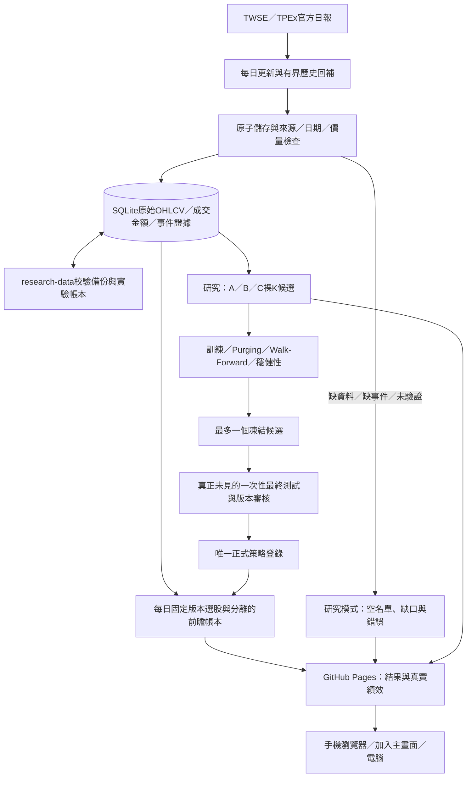

# 手機版與研究系統架構

手機只開啟GitHub Pages，同一響應式網站支援電腦；不需Python、券商連線或登入。K線保留台灣慣用紅漲綠跌，股票代號與名稱並列，內文字級沿用放大版。

目前V受最近一年污染阻擋，Q也尚欠完整歷史及公司行動，S為空。網站如實顯示「尚無通過驗證的策略」，沒有範例績效曲線。

正式與研究路徑分離：候選在`.state/experiments/`，核准版本在`strategies/`與`strategy_registry.json`，自動研究無權覆寫後者。舊四模型及真實K線快照保留於可展開的封存區。

每日台北18:30更新／發布，01:00限額回補／研究；排程延遲／部署錯誤時舊網站可能仍在，必須看行情日期與Actions狀態。來源錯誤時輸出明確錯誤與空名單。沒有合格股票不放寬條件；沒有正式策略不發布推薦。系統沒有任何實盤委託介面。
